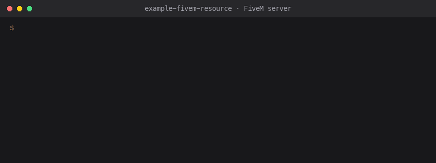

# FiveM resource with SunLicense

<!-- sunlicense:distribution -->
[](https://github.com/sunlicense-com/example-fivem-resource/actions/workflows/build.yml)
[](LICENSE)
[](https://docs.sunlicense.com/guide/templates)
[](https://sunlicense.com/start?ref=gh-fivem)

A working, copyable [FiveM](https://fivem.net) server resource (Lua) with [SunLicense](https://sunlicense.com)
built in: each server needs a valid license key, leaked keys can be revoked or blocked, and your
customers' servers keep running if SunLicense is ever unreachable.

- The official [Lua SDK](https://github.com/sunlicense-com/sunlicense-lua) (`lib/sunlicense.lua`), Lua 5.4, no other dependencies
- License key from a **server.cfg convar**; your API key written into the build you sell, never into git
- Clear console messages for every result (expired, revoked, too many servers, blacklisted, …), keys masked
- Re-checked every few hours, so a revoke reaches running servers (the resource stops itself)
- **Core unlock**: your features (`server/core.lua`) ship sealed and only run after a valid check; a copy with the check cut out can't open them. Modified copies are reported to Sentinel, and every console shows who owns the resource
- Tests with plain Lua (FiveM stubbed), CI on GitHub Actions, and [AGENTS.md](AGENTS.md) for AI coding assistants

Works on FiveM (GTA V); change `game` in `fxmanifest.lua` to `'rdr3'` for RedM. There's no offline
license file here (Lua has no Ed25519 built in): when SunLicense can't be reached the resource keeps
running and checks again later.

<p align="center"></p>

## Set up in one prompt

1. Click **Use this template** (or `gh repo create my-resource --template sunlicense-com/example-fivem-resource --private --clone`).
2. Open the folder in Claude Code, Cursor, Codex or Copilot and paste the prompt from
   **[sunlicense.com/prompt](https://sunlicense.com/prompt?ref=gh-fivem)**.

The agent installs the SunLicense CLI, creates a free guest account (no sign-up form; keep it by adding your email
later), a product, a policy and an API key, puts them where this template reads them ([AGENTS.md](AGENTS.md)) and
proves a license check comes back valid. Rather do it by hand? Make a
[free account](https://sunlicense.com/start?ref=gh-fivem) and follow the steps below.

## 1. Set up SunLicense

In the [dashboard](https://app.sunlicense.com):

1. **Products → New product** (your resource), then a **policy**, e.g. "Standard", *1 machine*: a machine is a server here.
2. **API keys → Create API key**. It can only validate licenses.
3. Connect your store under **Integrations**, e.g. [Tebex](https://docs.sunlicense.com/integrations/tebex), so every purchase gets a license.

## 2. Make it yours

1. Use this template (or copy the folder), then rename `my-resource`, the `my_resource_*` convars and the
   `my_resource_license` command.
2. Put it in your test server's `resources/` folder, and add to `server.cfg`:

   ```cfg
   set my_resource_license "YOUR-TEST-KEY"
   ensure my-resource
   ```

   While developing, put your API key in `settings.lua` locally (don't commit it), or build with
   `scripts/package.sh` and use `dist/my-resource`.
3. Your features go in `Core.start()` in `server/core.lua`, which runs only once the license is valid.
   Put your product name and your name in `settings.lua` (`product`, `owner`, optional `terms` link): the
   start-up notice shows them.

`my_resource_license` in the server console shows the license status. `lua tests/run.lua` runs the tests.

## 3. Sell it

```bash
SUNLICENSE_API_KEY=slk_... SUNLICENSE_PRODUCT=my-resource sh scripts/package.sh
```

`dist/my-resource` (and `dist/my-resource.zip`) is what buyers get, with your API key in `settings.lua`.
With `SUNLICENSE_PRODUCT` (your product's code) and the [CLI](https://docs.sunlicense.com/cli/) signed in
(or `SUNLICENSE_TOKEN` in CI), `server/core.lua` is sealed into `server/core.sealed` by `sunlicense seal`
and left out of the build: the key that opens it comes only with a valid license check. The digest of
`fxmanifest.lua` goes inside it (more files: `SUNLICENSE_DIGEST="fxmanifest.lua other.lua"`; only files
Tebex's escrow leaves readable), so a copy that loads extra scripts is reported as modified.
Upload it through **Tebex's asset escrow** (keymaster) so buyers can't read or change `settings.lua` or
the check. Buyers add `set my_resource_license "THEIR-KEY"` to `server.cfg`; the key reaches them by email
from your [Tebex](https://docs.sunlicense.com/integrations/tebex) store, or on the redeem page for the
other stores.

## What happens on a server

| SunLicense answers | The resource |
|---|---|
| Valid | Opens the sealed core and starts your features; logs the masked key |
| Expired, revoked, suspended, unknown key, too many servers, blacklisted | Logs why (see `MESSAGES` in `server/license.lua`) and stops itself |
| Nothing (outage, network, rate limit) | Keeps running and retries every 10 minutes (`ALLOW_WHEN_UNREACHABLE = false` to wait instead). The sealed core opens with the unlock from a valid check in the last 7 days (kept in the resource, bound to this server); on a server that never had one, it starts once SunLicense answers |

**Protection and its limit.** At start-up every console shows `My Resource is licensed software by You.
License AX8P-XXXX-XXXX-XXXX.` (never the full key or the buyer's name). A copy whose `fxmanifest.lua`
differs from the one you sealed sends `integrity: MODIFIED` with its next check; Sentinel suggests
suspending that license (never revokes on its own). Someone with a valid license can still extract the
unlock and patch their copy: protection raises the cost and makes leaks visible, it doesn't make code
uncrackable ([protection](https://docs.sunlicense.com/guide/protection)).

Each server keeps a random id in the resource's `.machine-id`, which is what counts against the policy's
machine limit. Re-checks every 6 hours (`set my_resource_recheck_hours 12` to change, 0 = only at start).

Developing against your own license? Add an **exclusion** for your machine or IP in SunLicense
([blacklists and exclusions](https://docs.sunlicense.com/guide/access-rules)) so test servers don't use up slots.

**Usage statistics.** Every 30 minutes, in the background, the resource tells SunLicense its version
(`fxmanifest.lua`), the FiveM server build and OS, so you see who runs what on the product's **Analytics**
tab (with the license and server, like bStats). No server, host or player names, no IP addresses. Server
owners switch it off with `set my_resource_analytics false` (or `set sunlicense_analytics false` for every
SunLicense resource) in `server.cfg`; it never affects the license check. Count your own features with
`analytics:feature('name')` and add charts with `analytics:simplePie(…)` and friends in `server/main.lua`.
What is sent: [docs](https://docs.sunlicense.com/guide/sdks#built-in-analytics).

## Files

```
fxmanifest.lua        the resource
settings.lua          URL and API key (empty in git; scripts/package.sh fills it in)
lib/sunlicense.lua    the official Lua SDK (license checks and usage statistics), unchanged
server/license.lua    the check: SunLicense's answer → status and message; opens the sealed core (no game code, tested)
server/main.lua       start-up, notice, re-checks, the console command
server/core.lua       your features (sealed into server/core.sealed in the build you sell)
tests/run.lua         every result against stubbed FiveM functions
scripts/package.sh    the folder you sell, with your API key and the sealed core
.github/workflows/build.yml   CI
```

## Links

- Docs: [all templates](https://docs.sunlicense.com/guide/templates) · [SDKs](https://docs.sunlicense.com/guide/sdks) ·
  [store integrations](https://docs.sunlicense.com/integrations/)
- [SunLicense](https://sunlicense.com/?ref=gh-fivem): license keys for software you sell, with store integrations,
  a Discord bot for your buyers and leak alerts. Free for 3 products and 100 licenses:
  [create an account](https://sunlicense.com/start?ref=gh-fivem).
- Questions or a bug in this template: [open an issue](https://github.com/sunlicense-com/example-fivem-resource/issues).

## Licence

[MIT No Attribution](LICENSE): copy any of it into your resource, commercial or not, without credit.
`lib/sunlicense.lua` is MIT (its header says so).
